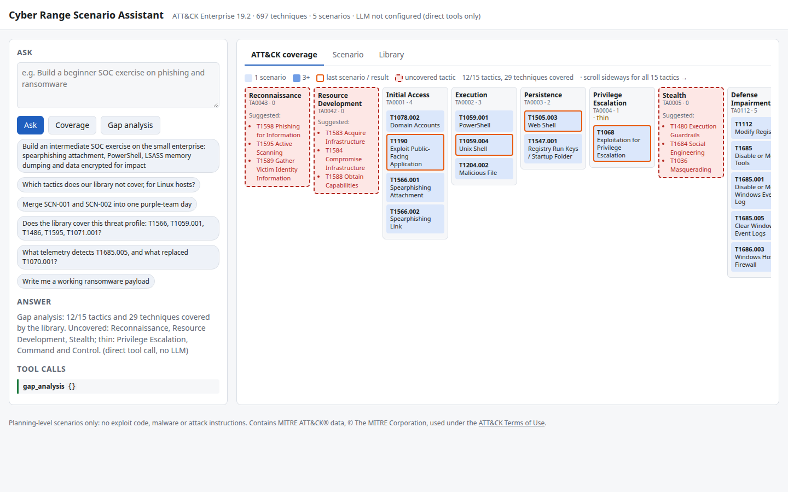

# Cyber Range Scenario Assistant

An LLM assistant that **generates, validates, aggregates and gap-analyses cyber range training
scenarios** mapped to MITRE ATT&CK Enterprise (19.2). You describe an exercise in plain language.
The LLM only picks one of eight whitelisted tools and fills Pydantic-validated arguments.
Deterministic, tested Python handles the rest: ordering steps along the kill chain, choosing
target hosts, deriving expected detections from ATT&CK data components, validating against a
JSON Schema, building the coverage matrix and finding gaps. Scenarios stay at **planning level**:
objectives, environment, ATT&CK-mapped steps, expected telemetry and trainee tasks. They never
contain exploit code, malware or attack instructions, and the assistant refuses to write any.



## What it can do

| Tool | What it does (deterministically) |
|------|----------------------------------|
| `build_scenario` | Techniques (`T1078` or `T1078@persistence`) → scenario: kill-chain order, target host by tactic and platform, expected detections, audience-specific trainee tasks, duration; validated before it is returned |
| `validate_scenario` | JSON Schema plus ATT&CK semantics: technique exists and belongs to its tactic, host exists, OS vs platforms, kill-chain order, durations, duplicate IDs, unknown data components |
| `coverage` | Tactic × technique matrix with the scenarios covering each cell |
| `gap_analysis` | Uncovered and thinly covered tactics with suggested techniques (most detection data first, platform filter), plus the techniques of a threat profile that no scenario covers |
| `aggregate_scenarios` | Merges scenarios into one exercise: environments merged (host conflicts reported), duplicate steps removed, steps renumbered, mixed audiences reported |
| `search_techniques`, `get_technique` | ATT&CK lookup by name/ID, tactic, platform. Revoked IDs point to their replacement (e.g. T1562.001 → T1685) |
| `list_scenarios` | The example library (5 scenarios, with some tactics left uncovered on purpose) |

The UI shows the coverage matrix: darker cells are covered by more scenarios, the last result is
outlined, and uncovered tactics appear dashed in red with suggestions. It also has a YAML viewer
with a validation badge and download, and the library table. The **Coverage** and
**Gap analysis** buttons call the tools directly, so they work without an LLM.

## Architecture

```
browser (web/index.html) ──► FastAPI (app/api.py) ──► agent loop (app/agent.py) ◄──► OpenAI-compatible LLM
                                    │                        │ tool calls
                                    └──── POST /tools ───────┴──► tools (app/tools.py, Pydantic args)
                                                                     └──► engine (app/scenarios.py)
                                                                           ├─ data/attack_enterprise.json
                                                                           ├─ schema/scenario.schema.json
                                                                           └─ scenarios/*.yaml
```

The LLM receives compact tool results (IDs, counts, validation). YAML and the full matrix go only to
the UI. See [docs/architecture.md](docs/architecture.md) for C4-style Mermaid diagrams, the request
sequence, the data model, requirements REQ-01 to REQ-12 traced to tests, and design decisions.

## Quick start

Requires Python 3.11+.

```bash
python -m venv .venv && source .venv/bin/activate
pip install -e ".[dev]"
cp .env.example .env            # add LLM_API_KEY (e.g. a Groq key) for /ask; tools work without it
uvicorn app.api:app --reload    # http://127.0.0.1:8000
```

Direct tool calls need no LLM:

```bash
curl -s localhost:8000/tools -H 'Content-Type: application/json' -d '{
  "tool": "build_scenario",
  "args": {"title": "Phishing drill", "techniques": ["T1566.001", "T1059.001", "T1486"],
           "level": "beginner", "audience": "soc-analyst"}}' | python -m json.tool | head -40

curl -s localhost:8000/tools -H 'Content-Type: application/json' -d '{
  "tool": "gap_analysis", "args": {"platforms": ["Linux"], "required_techniques": ["T1566", "T1595"]}}'
```

Ask in natural language (needs `LLM_API_KEY`):

```bash
curl -s localhost:8000/ask -H 'Content-Type: application/json' \
  -d '{"question": "Merge SCN-001 and SCN-002 into one purple-team day"}'
```

| Endpoint | |
|----------|-|
| `GET /health`, `/tactics`, `/scenarios`, `/scenarios/{id}`, `/coverage` | read-only |
| `POST /tools` `{tool, args}` | direct tool call, no LLM |
| `POST /ask` `{question}` | LLM tool loop. Rate-limited per IP (`RATE_LIMIT_PER_HOUR`); returns 502 if the LLM is unreachable, 503 if no key is set |

## Docker

```bash
docker build -t cyber-range-assistant .
docker run --rm -p 8000:8000 --env-file .env cyber-range-assistant
```

The image is `python:3.12-slim` and runs as a non-root user. It listens on `$PORT` (default 8000).

## Scenario format

`schema/scenario.schema.json` uses JSON Schema draft 2020-12 with `additionalProperties: false`.
The top-level fields are `id` (SCN-nnn), `title`, `version`, `attack_version`, `level`, `audience`,
`duration_minutes`, `objectives`, `tags`, `environment.segments[].hosts[]` (name, os, role) and
`steps[]`. One step from [scenarios/SCN-001.yaml](scenarios/SCN-001.yaml):

```yaml
- id: S1
  title: 'Initial Access: Spearphishing Attachment'
  tactic: initial-access
  technique: T1566.001
  description: 'The adversary emulation performs Spearphishing Attachment (T1566.001, Initial Access) against ws01
    (workstation, Windows). Planning level: the range operator selects an approved emulation from the range catalogue;
    no procedure is specified here.'
  target_host: ws01
  duration_minutes: 15
  expected_detections: [Application Log Content, File Creation, Network Connection Creation, Network Traffic Flow,
    Process Creation]
  trainee_tasks:
  - Triage the SIEM alert for Spearphishing Attachment (T1566.001) on ws01
  - 'Confirm the activity in the telemetry: Application Log Content, File Creation, Network Connection Creation (+2 more)'
  - Record severity, scope and an escalation decision in the ticket
```

There are two environment presets. `small-enterprise` has an attacker, a DMZ (web, mail), a
corporate LAN (2 workstations, domain controller, file server) and a SOC SIEM. `linux-web` has an
attacker, a web server, a database and a SIEM.

## Quality

- **Tests:** 70 offline pytest tests (`pytest`). They cover the engine, the tools, the agent loop
  against a fake OpenAI client, and the API with the agent monkeypatched (rate limit, 502, 503).
  No network or API key is needed.
- **Lint:** `ruff check .` and `ruff format --check .` (line length 110).
- **Library check:** `python scripts/validate_library.py` validates every scenario against the
  schema and ATT&CK.
- **CI** ([.github/workflows/ci.yml](.github/workflows/ci.yml)) runs lint, library validation and
  tests on Python 3.11 and 3.12, then a Docker build with a `/health` smoke test.
- **LLM evaluation:** `eval/cases.jsonl` holds 15 requests (14 with an expected tool and argument
  subset, plus 1 refusal). `python eval/run_eval.py` measures tool-selection accuracy, argument
  accuracy and refusal pass rate on the configured model, and writes details to `eval/results/`.
  No figures are quoted here until the eval has been run.

## Updating ATT&CK

```bash
python scripts/build_attack_data.py     # downloads the latest STIX bundle, prints version and tactics
python scripts/make_library.py          # rebuilds the example library (fails on unknown IDs)
python scripts/validate_library.py && pytest
```

The script prints the ATT&CK version and tactic list. Recent releases renamed or added tactics
(`stealth`, `defense-impairment` in v19) and renumbered techniques. The tests check that every
tactic and technique the code references still exists.

## Licence and data attribution

The code is under the [MIT licence](LICENSE).

`data/attack_enterprise.json` is derived from [MITRE ATT&CK®](https://attack.mitre.org/)
Enterprise STIX data. © The MITRE Corporation. This work is reproduced and distributed with the
permission of The MITRE Corporation. MITRE ATT&CK and ATT&CK are registered trademarks of The
MITRE Corporation. Use is subject to the
[ATT&CK Terms of Use](https://attack.mitre.org/resources/legal-and-branding/terms-of-use/).
