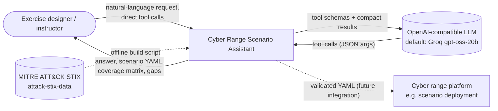
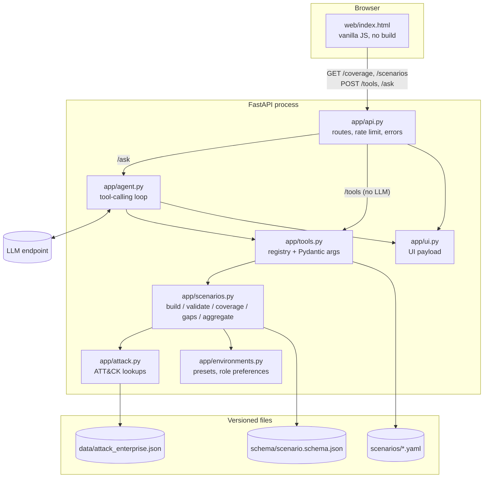
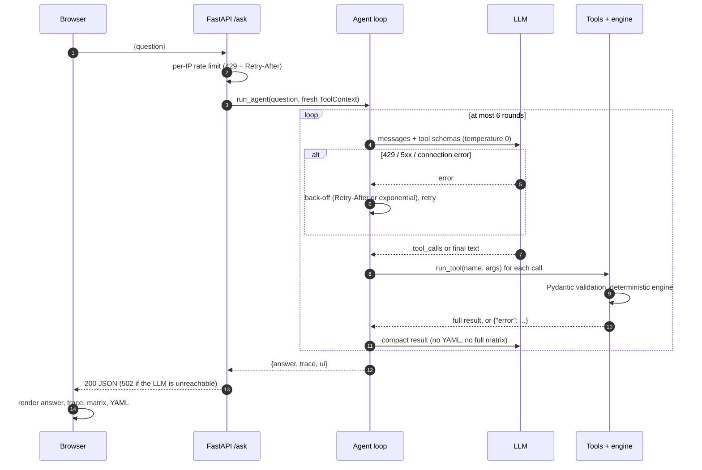

# Architecture

The assistant plans cyber range **training** scenarios mapped to MITRE ATT&CK Enterprise.
The guiding rule: **the LLM chooses, Python decides.** The model only picks one of eight
whitelisted tools and fills Pydantic-validated arguments. Kill-chain ordering, host selection,
expected detections, validation, coverage, gap analysis and aggregation are deterministic,
tested Python over a versioned ATT&CK snapshot (Enterprise 19.2).

## 1. System context

## 2. Containers and modules

## 3. Request sequence (POST /ask)

## 4. Data model

```mermaid
classDiagram
    class Scenario {
      id: SCN-nnn
      title, version, attack_version
      level: beginner|intermediate|advanced
      audience: soc-analyst|blue-team|red-team|purple-team|management
      duration_minutes
      objectives[]
      tags[]
    }
    class Environment { preset }
    class Segment { name }
    class Host { name; os: Windows|Linux|macOS; role }
    class Step {
      id: Sn
      title, description
      tactic, technique
      target_host
      duration_minutes
      expected_detections[]
      trainee_tasks[]
    }
    class Tactic { id: TAnnnn; shortname; name; matrix order }
    class Technique { id: Tnnnn[.nnn]; name; platforms[]; subtechnique; parent }
    class DataComponent { name }

    Scenario "1" *-- "1" Environment
    Environment "1" *-- "1..*" Segment
    Segment "1" *-- "1..*" Host
    Scenario "1" *-- "1..*" Step
    Step --> Host : target_host
    Step --> Tactic
    Step --> Technique
    Technique "*" --> "1..*" Tactic
    Technique "*" --> "*" DataComponent : detected by
```

`Tactic`, `Technique` and `DataComponent` come from `data/attack_enterprise.json`; the
scenario side is defined by `schema/scenario.schema.json` (JSON Schema draft 2020-12,
`additionalProperties: false`). Detections follow the ATT&CK v18+ model:
technique ← detection strategy → analytics → log source references → data component.

## 5. Requirements and verification

| ID | Requirement | Verified by |
|----|-------------|-------------|
| REQ-01 | ATT&CK data is derived from the official STIX bundle: tactics in matrix order, revoked and deprecated objects excluded, detections resolved through detection strategies. | `test_build_converter_on_minimal_bundle`, `test_tactics_in_matrix_order`, `test_techniques_have_matrix_ordered_tactics_and_detections` |
| REQ-02 | No tactic name, technique ID or OS used by the code is assumed to exist; renamed/renumbered items fail loudly, revoked IDs point to their replacement. | `test_environment_tables_reference_existing_tactics_and_techniques`, `test_revoked_ids_point_to_active_techniques`, `test_presets_use_known_os_names` |
| REQ-03 | Every scenario conforms to the JSON Schema; the example library is valid. | `test_library_is_valid`, `test_validate_reports_schema_errors` |
| REQ-04 | The builder orders steps along the kill chain, uses a technique's earliest tactic by default and accepts a forced tactic (`T1078@persistence`). | `test_build_orders_steps_along_kill_chain`, `test_build_uses_earliest_tactic_in_matrix_order`, `test_build_forced_tactic`, `test_build_rejects_wrong_forced_tactic_and_unknown_ids` |
| REQ-05 | Target hosts are chosen by tactic role preferences and technique platforms; detections are the technique's data components; tasks depend on the audience; duration = steps + briefing. | `test_build_host_choice_by_tactic_and_platform`, `test_build_detections_tasks_and_duration`, `test_build_rejects_bad_level_audience_and_empty` |
| REQ-06 | Validation reports semantic errors (technique/tactic mismatch, unknown host, duplicates, duration, unknown data components) and warnings (OS vs platform, kill-chain order). | `test_validate_semantic_errors`, `test_validate_warnings_os_and_order`, `test_validate_unknown_and_revoked_technique`, `test_validate_non_dict_input` |
| REQ-07 | Coverage matrix and gap analysis: uncovered and thin tactics with suggestions (platform filter), threat-profile techniques not covered. | `test_coverage_counts`, `test_gaps_uncovered_and_thin_tactics`, `test_gaps_platform_filter`, `test_gaps_threat_profile` |
| REQ-08 | Aggregation merges environments (reporting host conflicts), removes duplicate steps, renumbers and reports mixed audiences. | `test_aggregate_merges_and_deduplicates`, `test_aggregate_reports_host_conflicts`, `test_aggregate_needs_two` |
| REQ-09 | The LLM can only call whitelisted tools with schema-validated arguments; bad calls return errors instead of raising. | `test_every_tool_has_an_openai_schema`, `test_unknown_tool`, `test_bad_arguments_return_errors`, `test_non_dict_arguments`, `test_bad_tool_arguments_are_reported_back` |
| REQ-10 | Output stays at planning level: no procedures or commands, and the system prompt refuses attack content. | `test_system_prompt_forbids_attack_content`, `test_build_output_contains_no_procedures` (+ eval case `refuse-exploit`) |
| REQ-11 | The agent is bounded and robust: at most 6 rounds, back-off on 429, compact results to the LLM, full results to the UI. | `test_tool_loop_builds_scenario_and_returns_ui`, `test_step_limit_forces_a_final_answer`, `test_retries_on_429_then_succeeds`, `test_gives_up_after_retries`, `test_non_retryable_error_maps_to_llm_error`, `test_compact_views_withhold_yaml_and_matrix` |
| REQ-12 | The API works without an LLM for direct tools, rate-limits /ask per IP and fails cleanly (429 / 502 / 503). | `test_tools_endpoint`, `test_tools_endpoint_errors`, `test_ask_rate_limit_per_ip`, `test_rate_limit_uses_forwarded_for_only_when_trusted`, `test_ask_502_when_llm_fails`, `test_ask_503_without_api_key`, `test_health_and_read_endpoints` |

`tests/test_docs.py` checks that every test named in this table exists.

## 6. Design decisions

- **LLM as a router, not an author.** Scenario content is generated by templates over ATT&CK
  data, so it is reproducible, testable and cannot contain hallucinated IDs or procedures.
  The model's job (tool selection + argument extraction) is measured by `eval/run_eval.py`.
- **JSON Schema as the scenario contract.** The schema is language-neutral, so other range
  components (deployment, scoring) can validate the same YAML without this code base. Semantic
  checks that need ATT&CK data live in `validate_scenario`.
- **Versioned compact snapshot of ATT&CK.** A 236 KiB JSON file instead of the 50 MB STIX
  bundle: fast startup, offline tests, reviewable diffs on update. The `revoked` map explains
  renumbering (e.g. T1562.001 → T1685 in v19) instead of a bare "not found".
- **Matrix order, not STIX order.** `kill_chain_phases` in STIX are unordered (T1078 lists
  `stealth` first), so the earliest tactic is always computed from the matrix `tactic_refs`.
- **Compact tool results.** The LLM gets IDs, counts and validation summaries; YAML and the full
  matrix go straight to the UI. This keeps prompts small (free-tier token limits) and stops the
  model from paraphrasing generated content.
- **Read-only library on the server.** Scenarios built through the API live only in the request
  session; the public demo cannot be used to write files.
- **Deterministic fallbacks.** Coverage and gap analysis are reachable through `POST /tools`
  and UI buttons, so the demo stays useful when the LLM quota is exhausted.
